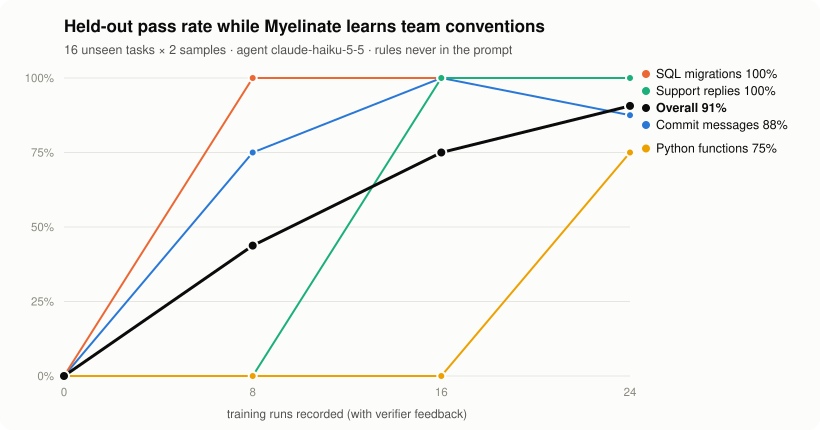

# Benchmark

Can an agent learn a team's conventions from feedback alone, with no prompt edits and no fine-tuning?

Every team has rules a general-purpose model can't know: how commit messages are formatted, what a migration must
contain, how support replies open and close, which docstring style code review expects. Normally someone writes
those into a prompt by hand. This benchmark checks whether Myelinate can learn them automatically from the same
signal a team already has: CI and review-bot feedback.

## Setup

| | |
|---|---|
| Agent | Claude Haiku 5.5, fixed generic system prompt. **The rules are never in the prompt.** |
| Learning model | Claude Opus 5.5 (Myelinate's reflection, curation and evolution) |
| Task families | Commit messages, PostgreSQL migrations, customer-support replies, Python functions |
| Verifiers | Deterministic checks per family that report every violated rule, CI-style (see [`tasks.py`](https://github.com/notaaaronfr/myelinate/blob/main/benchmarks/house_rules/tasks.py)) |
| Training | 24 tasks (6 per family). Each run is recorded with `verification={passed, details}` |
| Evaluation | 16 held-out tasks (4 per family) never seen in training, each sampled twice. Evaluation runs are not recorded, so they can't teach |
| Checkpoints | Before learning, then after every 8 training runs |

The rules, which the agent must discover:

- **Commit messages:** `type(scope): description` in lower case, no final period, at most 60 characters, a body, and
  a final `Refs: <ticket>` trailer.
- **Migrations:** wrapped in `BEGIN;` / `COMMIT;`, `IF NOT EXISTS` on every create or add, and a `-- down:` rollback
  section.
- **Support replies:** open with `Hi <first name>,`, cite the ticket as `#<number>`, sign off with `— Acme Support`,
  and never promise a refund.
- **Python:** type annotations on everything, a Google-style docstring with `Args:`, `Returns:` and `Raises:`, and
  `ValueError` on invalid input.

## Reproduce

```bash
echo "ANTHROPIC_API_KEY=sk-ant-..." >> .env
set -a; . ./.env; set +a
uv run python benchmarks/house_rules/run.py --epochs 1     # writes results.json
uv run python benchmarks/house_rules/chart.py              # renders docs/assets/benchmark-{light,dark}.svg
```

A one-pass run takes about 10 minutes.

## Results

<picture>
  <source media="(prefers-color-scheme: dark)" srcset="assets/benchmark-dark.svg">
  
</picture>

Held-out pass rate (16 unseen tasks × 2 samples) after each block of training runs:

| Training runs | Commit messages | SQL migrations | Support replies | Python functions | Overall |
|---|---|---|---|---|---|
| 0 | 0% | 0% | 0% | 0% | **0%** |
| 8 | 75% | 100% | 0% | 0% | **44%** |
| 16 | 100% | 100% | 100% | 0% | **75%** |
| 24 | 88% | 100% | 100% | 75% | **91%** |

- **0% → 91%** on tasks the agent never trained on, from verifier feedback alone.
- Each family jumps right after its first training runs. Training is ordered family by family, so the curve shows each
  convention being picked up as soon as feedback about it arrives.
- Learning used 72 model calls (reflect 22, curate 9, memory 7, judge_skill 30, evolve 4).
  Total cost: about **$1.25** at list prices (an upper bound; prompt caching makes it lower). Wall time
  5 minutes.
- The skills it learned are in [`results.json`](https://github.com/notaaaronfr/myelinate/blob/main/benchmarks/house_rules/results.json) (`skills_learned`), exported as standard SKILL.md.

## Run history

Each run's raw output is kept in this folder. The benchmark found real product issues, which were fixed between runs:

| Run | Change before the run | Held-out pass rate (start → end) | Learning cost (upper bound) |
|---|---|---|---|
| 1 ([`results-run1.json`](https://github.com/notaaaronfr/myelinate/blob/main/benchmarks/house_rules/results-run1.json)) | First run | 0% → 84% | about $2 |
| 2 ([`results-run2.json`](https://github.com/notaaaronfr/myelinate/blob/main/benchmarks/house_rules/results-run2.json)) | Curator told never to invent specific values; 2 passes over the training data | 0% → 66% (peak 72%) | about $7.80 |
| 3 ([`results.json`](https://github.com/notaaaronfr/myelinate/blob/main/benchmarks/house_rules/results.json)) | Curator keeps required formats verbatim and writes output-focused rules; commit check reports every violation (as real commitlint does) | **0% → 91%** | about $1.25 |

What runs 1 and 2 taught:

- **Invented specifics.** In run 1 the curator wrote "length within the configured limit (typically 72-100
  characters)", a value no feedback had mentioned. That rule was wrong, and commits stalled at 50%.
- **Placeholders replacing required formats.** In run 2 the instruction to generalise rules turned the required
  literal `-- down:` into "a down section". The agent then wrote `-- rollback`, which fails the check. Run-specific
  values (ticket ids, table names) should become placeholders; convention markers should not.
- **Rules the agent can't act on.** A learned rule said to "check the repo's commitlint config". The agent has no repo
  access, so it narrated that it couldn't, and the narration broke the output.

## Limits

- Small sample: 8 evaluations per family per checkpoint, so single-family numbers move in steps of 12.5 points.
- Synthetic tasks with deterministic verifiers. Real tasks have fuzzier signals, which is why Myelinate gates skill
  changes on signal strength and canaries them on live traffic.
- One agent model and one learning model. The method is model-agnostic, but these numbers are for this pair.
