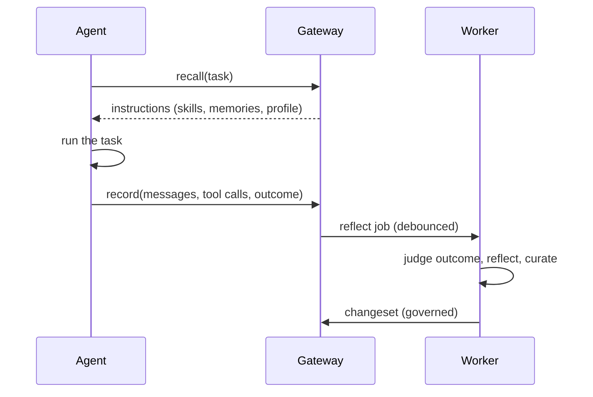

# Concepts

This page explains the moving parts and the reasoning behind them. You don't need it to get started, but it makes
the settings and the governance workflow much easier to reason about.

## Tenants, agents and users

Everything is scoped by three keys:

| Key | Comes from | Purpose |
|---|---|---|
| **Tenant** | The authenticated credential (never the request body) | Hard isolation between customers or business units |
| **Agent** (`agent_id`) | The request | A knowledge namespace. Agents with the same id share skills. `*` holds skills shared by every agent in the tenant; only reviewers can publish there |
| **User** (`user_id`) | The request, optional | Scopes preferences, user-specific facts and the profile card |

## The learning loop

The hot path, `recall` and `record`, makes no LLM calls: it is a few database queries. All learning happens in
background jobs, so Myelinate never adds model latency to your agent.

## Skills and rules

A **skill** is a named procedure, such as `postgres-schema-migration`. Its content is a list of **rules** (also
called bullets), each one short and specific: *"When adding a NOT NULL column to a populated table, include a
DEFAULT."* Rules are grouped into sections: steps, pitfalls, heuristics, verification, snippets and notes. Skills
export to, and import from, the standard `SKILL.md` format.

Each rule keeps its own record of how often it was used and how often it was judged **helpful**, **harmful** or
**neutral**. Each skill keeps a success-rate estimate (a Beta posterior) built from the outcomes of runs that used it.

Why rules instead of documents: research on evolving agent context (ACE, ICLR 2026) found that rewriting whole
documents gradually erodes them ("context collapse"), while small itemised edits keep detail and improve results far
more. So Myelinate only ever edits individual rules, and only a few per change.

## Episodes and signals

An **episode** is one recorded run: the task, messages, tool calls, outcome and any verification. Learning quality
depends on how reliable the outcome signal is, so Myelinate ranks signals:

1. **Verification**: tests, validators or business checks (`verification.passed`)
2. **Feedback**: a user's rating or correction (`/v1/feedback`)
3. **Reported outcome**: `success`, `failure` or `partial` from your code
4. **LLM judge**: an estimate when nothing else is available, with a confidence score

Episodes with only a weak signal (no label and a low-confidence judgment) can still teach **memories**, but they can
never change **skills**. Learning from unreliable feedback is documented to make agents worse than not learning at
all, so this guardrail matters.

## Reflection and curation

When enough episodes accumulate, after a failure, or after a tool-heavy run, a worker **reflects** on each episode:
what drove the outcome, which injected rules helped or hurt, and which facts are worth remembering. A **curator** then
turns the reflections into a few typed edits:

| Edit | Meaning | Risk |
|---|---|---|
| `create_skill`, `add` | New skill or new rule | Low |
| `update` | Sharpen or correct an existing rule | Medium |
| `remove` (as a merge) | Drop a duplicate, keeping its evidence | Medium |
| `remove`, `set_description` | Delete a rule or change when a skill is used | High |

## Changesets and governance

Every change to skills is a **changeset**: a batch of edits with a rationale, the episodes it came from, a risk
level and any safety findings. Policy decides what happens next:

- Changes flagged by the safety scan (secrets, prompt-injection patterns) are never applied automatically.
- Low-risk changes are applied automatically by default.
- Medium- and high-risk changes wait for human review.
- A changeset only applies to the exact skill version it was written against. If the skill changed in the
  meantime, it fails instead of being silently merged.

Each applied changeset creates an immutable **version** of the skill, and any version can be restored with a rollback.
See [Governance](../operations/governance.md).

## Canary experiments and the holdout group

A change to a skill that is already in regular use isn't applied straight away. It runs as a **canary**: on live
traffic, each run gets either the current version or the candidate, chosen by Thompson sampling, with each user or
session kept on one version. When the evidence is clear (95% posterior probability by default), the candidate is
promoted or rejected automatically. Inconclusive canaries expire and keep the current version.

Separately, a small **holdout** share of runs (5% by default) gets no learned skills. Comparing those runs with
treated runs on the same kinds of tasks gives the **learning lift**: the causal improvement Myelinate is delivering,
with a credible interval. Find it in `GET /v1/agents/{agent_id}/insights`.

## Evolution

Skills that underperform, or that contain rules repeatedly marked harmful, are queued for **evolution**. This is a
search over small edits, modelled on GEPA:

1. Past runs of the skill are split into a feedback set and a held-out set.
2. An LLM proposes edits based on the failures in a small batch.
3. A candidate must beat its parent on that batch, then is scored on the held-out runs.
4. The best candidate must beat the current skill by a clear margin, with ties losing.

Edits that drop too many rules are rejected, and previously rejected edits are shown to the model so it doesn't repeat
them. A winning candidate becomes a changeset like any other, so it still goes through review and canary.

## Memory and profiles

**Memories** are short facts: `fact` (about the environment), `preference` (about a user) and `lesson` (a mistake to
avoid). Each new memory is reconciled against similar existing ones: it is added, merges with one (update), replaces one
that it contradicts (supersede), or is dropped as already known. Superseded memories are kept, with the time they
stopped being true, so you can ask what the agent knew at any point (`as_of`). Each user also gets a short **profile
card** summarising their preferences.

## Upkeep

A periodic **curation** job keeps the library healthy:
- It merges near-duplicate rules (an LLM decides, and "keep both" decisions are remembered).
- It marks unused skills stale, then archives them. Nothing is deleted, and pinned skills are exempt.
- It queues weak skills for evolution, expires stuck canaries and refreshes profile cards.

## Where the ideas come from

Myelinate combines mechanisms from ACE and its Kayba implementation, GEPA, SkillOpt, Trace2Skill, WikiSkill,
ReasoningBank, Mem0, Zep/Graphiti, Honcho, Hermes Agent, Letta, LangMem, Voyager and Agent Workflow Memory. It adds
live canary rollout, a holdout measurement of causal lift, and enterprise governance. See
[Architecture](../reference/architecture.md).
