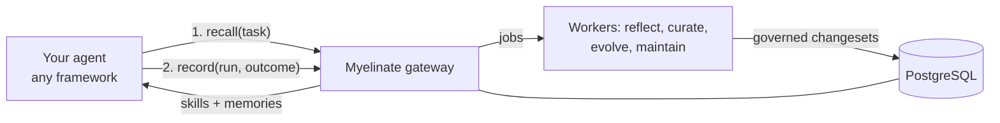

# Myelinate

**Self-improving skills and memory for any AI agent framework, with governance built in.**

Myelinate is a gateway your agents call before and after each run. Before a run it returns the skills and memories
that apply to the task. After the run it records what happened. In the background it learns: it turns failures,
successes and user corrections into reusable skills, improves skills that underperform, and remembers facts and
preferences. Every change is reviewed by policy or a human, tested on live traffic, versioned and reversible.

> *Myelin* is the sheath the brain builds around pathways that get used, and that work, so they fire faster and more
> reliably. Myelinate does the same for agents.

## Does it work?

In the [house-rules benchmark](benchmark.md), an agent learns team conventions it was never told from CI-style
feedback alone. On tasks it never trained on, its pass rate went from **0% to 91% after 24 runs**.

<picture>
  <source media="(prefers-color-scheme: dark)" srcset="assets/benchmark-dark.svg">
  
</picture>

## Why Myelinate

- **Works with your framework.** Plugs into Microsoft Agent Framework, OpenClaw, LangGraph, CrewAI, the OpenAI Agents
  SDK, Google ADK, anything that speaks MCP or emits OpenTelemetry traces, and plain REST from any language.
- **Learns the right way.** Skills are lists of small rules that are edited one at a time, never rewritten wholesale.
  Each rule tracks whether it helped. Skills only change on reliable evidence (tests, feedback, confident judgments).
- **Proves it works.** Changed skills are tested against the current version on live traffic before rollout, and a
  small control group measures how much learning actually improves your success rate.
- **Built for enterprises.** Tenants, scoped API keys, SSO (Entra ID, Okta, Auth0, Keycloak), approval workflows, an
  audit log, PII redaction, right to erasure, per-tenant budgets, Prometheus metrics and OpenTelemetry tracing.

## How it fits

## Where to start

| You want to... | Go to |
|---|---|
| Try it locally in five minutes | [Quickstart](getting-started/quickstart.md) |
| Understand skills, episodes, changesets and canaries | [Concepts](getting-started/concepts.md) |
| Connect your agent | [Integrations overview](integrations/overview.md) |
| Run it in production | [Docker](deployment/docker.md), [Kubernetes](deployment/kubernetes.md), [Production checklist](deployment/production-checklist.md) |
| Set up SSO and permissions | [Security and SSO](operations/security.md) |
| Decide what gets auto-approved | [Governance](operations/governance.md) |
| Look up a setting or endpoint | [Configuration](reference/configuration.md), [REST API](reference/api.md) |
