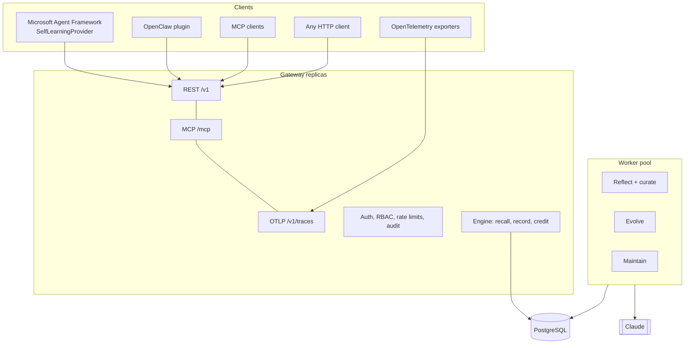

# Architecture

## Components

| Module | Responsibility |
|---|---|
| `gateway/app.py`, `gateway/auth.py`, `gateway/mcp_server.py` | HTTP surface, authentication, scopes, rate limits, MCP tools |
| `engine.py` | Recall (retrieval, canary arms, holdout), record (redaction, credit), feedback, insights, export |
| `learning.py` | Outcome signals, outcome judge, reflection, evidence gating, curation |
| `evolution.py` | GEPA-style search with a held-out gate |
| `governance.py` | Changesets, risk policy, approval, canary experiments, versions, rollback |
| `memory.py` | Memory reconciliation, validity intervals, profile cards |
| `maintenance.py` | Dedup, lifecycle, evolution nomination, canary expiry |
| `skills.py` | Edit operations, simulation, diffs, SKILL.md rendering and parsing, lint |
| `retrieval.py`, `embeddings.py` | BM25 plus optional dense retrieval, fused with reciprocal-rank fusion, then MMR for diversity |
| `experiments.py` | Beta posteriors, Thompson sampling, lift intervals |
| `otel.py` | OTLP JSON to episodes |
| `worker.py`, `core.py` | Durable job queue, leases, heartbeats, LLM metering and budgets |

## Request paths

**Recall** (no LLM call):
1. Load the agent's live skills.
2. Rank them by relevance multiplied by each skill's success estimate, then diversify the top results.
3. Pick a canary arm where an experiment is running, or apply the holdout.
4. Add the profile card and relevant memories.
5. Log the recall and return the instructions.

**Record** (no LLM call):
1. Redact PII.
2. Store the episode with the recall's served skills and injected rules.
3. Update usage counters, using atomic SQL increments.
4. Queue reflection and curation, with debouncing.
5. Credit the reward to the skills, canary arms and lift statistics.

**Background jobs** run in workers. Claiming a job is a conditional update, so many workers share one queue safely.
At most one job runs per dedupe key at a time (for example, one reflection per agent). Running jobs hold a lease that a
heartbeat extends, and failed jobs retry with backoff. Jobs that hit a tenant's token budget are deferred, not failed.

## Data model

| Table | Holds |
|---|---|
| `skills`, `bullets`, `skill_versions` | Skills, their rules with evidence counters, immutable snapshots |
| `changesets`, `experiments`, `pair_decisions` | Proposed edits and their review, canaries, remembered dedup decisions |
| `memories`, `profiles` | Memories with validity intervals, per-user profile cards |
| `episodes`, `recalls` | Recorded runs, what was served for each recall |
| `agent_state` | Reflection counters and holdout and treated statistics per agent |
| `jobs`, `llm_usage`, `audit_log`, `api_keys` | Job queue, token metering, audit trail, hashed API keys |

All rows carry a `tenant_id`. Every query is scoped by the tenant of the authenticated principal.

## Design decisions

| Decision | Why |
|---|---|
| Rules edited by small typed operations, never rewritten | Whole-document rewrites erode context; itemised deltas keep detail (ACE) |
| Bounded edits per changeset | Unbounded rewrites underperform and drift (SkillOpt) |
| Evidence gating on skill changes | Learning from unreliable feedback degrades agents (ACE, Dynamic Cheatsheet) |
| Strict held-out gate and rejected-edit buffer for evolution | Avoids overfitting and repeated bad edits (GEPA, SkillOpt, WikiSkill) |
| Canary on live traffic and holdout | Offline judges are proxies; real outcomes decide. Lift proves value |
| Memories superseded, not deleted | Audits and point-in-time questions need history (Zep) |
| No LLM on the hot path | Agent latency stays at database speed |
| Everything is a changeset | One governance path for learning, evolution, curation and human edits |
